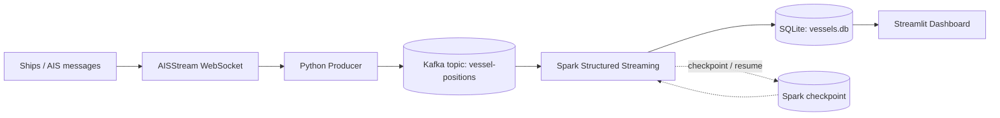

<div align="center">

# 🚢 Hamburg Port | Live Vessel Monitoring

**An end-to-end real-time data streaming project using live AIS vessel reports.**

From maritime events to an interactive monitoring dashboard — powered by Python, Apache Kafka, Apache Spark, SQLite, and Streamlit.


</div>

---

## Overview

This project monitors vessel activity in the **Port of Hamburg, Germany** using real AIS (Automatic Identification System) messages. A Python producer receives events from AISStream and publishes them to Kafka. Apache Spark Structured Streaming consumes and processes those events, SQLite stores the resulting records, and Streamlit displays an interactive near-real-time dashboard.

**Project objective:** demonstrate a working streaming pipeline with monitoring, duplicate prevention, restart recovery, and measurable performance.

## Architecture



| Component | Responsibility |
|---|---|
| AISStream | Source of real AIS vessel-position reports |
| Python producer | Receives AIS messages, extracts fields, and publishes to Kafka |
| Apache Kafka | Buffers and retains messages for streaming consumers |
| Apache Spark | Processes Kafka records in micro-batches |
| SQLite | Stores processed observations and supports duplicate prevention |
| Streamlit | Displays vessel positions, statistics, alerts, and recent activity |
| Docker | Runs Kafka and the Spark application locally |

## Dashboard Features

- **Live vessel map** showing recently received position reports
- **Recently detected vessels** based on distinct MMSI values within a recent time window
- **Moving-vessel statistics** and **configurable speed alerts**
- **Incoming report activity**, historical counts, and an hourly chart
- **Estimated port-entry events** based on a defined geographic boundary
- **Automatic producer reconnection** after temporary AISStream connection failures

> **Interpretation note:** A recently detected vessel is not necessarily a vessel physically inside the port. Port entries are geographic estimates, not official arrival records. The speed alert threshold is a project rule, not a legal speed-limit determination.

## Project Files

```text
hamburg-port-monitor/
├── kafka_producer.py       # Receive live AIS data and publish to Kafka
├── spark_stream.py         # Stream processing and SQLite writes
├── dashboard.py            # Streamlit monitoring dashboard
├── docker-compose.yml      # Local Kafka service
├── check_latency.py        # Processing-latency measurement
├── .env.example            # API-key configuration template (safe to share)
├── .gitignore              # Keeps local data and secrets out of Git
└── README.md
```

Additional local files, including `.env`, `.venv/`, `vessels.db`, and `spark-checkpoint/`, are intentionally **not** committed.

## Run Locally

### Prerequisites

- Windows with Docker Desktop running (including its Linux/WSL backend)
- Python and a Python virtual environment
- A valid [AISStream](https://aisstream.io/) API key
- Project-specific Python packages installed in the virtual environment

### 1. Configure your API key

In the project folder, create `.env` from `.env.example`:

```powershell
Copy-Item .env.example .env
```

Edit `.env` and replace `REPLACE_WITH_YOUR_API_KEY` with your own AISStream key. **Never commit `.env`.**

### 2. Start Kafka

```powershell
docker compose up -d
```

### 3. Run the producer

In a separate VS Code terminal, with the virtual environment active:

```powershell
python kafka_producer.py
```

### 4. Start Spark Structured Streaming

Open another terminal in the project folder:

```powershell
docker run --rm --network container:hamburg-port-monitor-kafka-1 -e HOME=/tmp -v "${PWD}:/opt/project" -w /opt/project apache/spark:3.5.7-scala2.12-java17-python3-ubuntu /opt/spark/bin/spark-submit --master "local[2]" --conf spark.jars.ivy=/tmp/ivy2 --packages org.apache.spark:spark-sql-kafka-0-10_2.12:3.5.7 spark_stream.py
```

### 5. Launch the dashboard

In a fourth terminal:

```powershell
python -m streamlit run dashboard.py
```

Open **http://localhost:8501** (or the URL printed by Streamlit).

### 6. Shut down safely

Stop the producer, Spark, and Streamlit using **Ctrl+C** in their terminals. Then stop the Kafka container:

```powershell
docker compose stop
```

This stops the services without intentionally deleting Kafka volumes or your saved project data. Do **not** use `docker compose down -v` unless you specifically intend to delete Docker-managed volumes.

## Testing and Observed Results

The table below reports measurements from specific local tests; these are **not** production guarantees or maximum-capacity benchmarks.

| Test | Observed result | Scope |
|---|---:|---|
| Live processing latency | **0.99 s average** | 177 recent reports; producer receipt to database-write timestamp |
| Observed incoming throughput | **1.0 report/s** | 60 reports collected over 60 seconds |
| Spark restart and catch-up | **167 / 167 recovered** | Reports received by Kafka during a controlled Spark interruption |
| Duplicate protection | **Passed** | Two deliberately repeated test observations resulted in one stored observation |
| 20% increased-load test | **Completed (with timing limitation)** | 132/132 reports saved successfully |

**Latency definition:** This project measures the elapsed time from when the Python producer receives a report to when Spark assigns the SQLite save timestamp. It does not measure ship-to-AISStream transmission latency or exact disk-commit duration.

**Recovery scope:** During the tested interruption, Kafka stayed available and retained the incoming reports. Recovering messages depends on Kafka retention and the Spark checkpoint. Reports missed while the AIS source or producer itself is disconnected are not automatically recovered.


### 20% Increased-Load Test Results

The load test was executed using recorded AIS observations, an isolated Kafka topic, Apache Spark, and a separate SQLite database.

| Metric | Baseline | Increased-load phase |
|---|---:|---:|
| Reports sent | 60 | 72 |
| Reports saved | 60 | 72 |
| Target rate | 1.0/sec | 1.2/sec |
| Actual rate | 1.000/sec | 0.217/sec |
| Average latency | 1.323 s | 22.364 s |
| P95 latency | 2.765 s | 146.254 s |

**Result:** The test execution is complete, with 132/132 reports successfully stored (100% delivery). However, laptop interruption affected the increased-load phase, so its intended 1.2 reports/second performance was not verified. An uninterrupted rerun is needed to validate the performance target.
## Design Decisions and Limitations

- **Kafka** separates data ingestion from downstream processing and supports catch-up after a consumer interruption.
- **Spark Structured Streaming** processes incoming Kafka records in micro-batches; the current demonstration runs locally with two Spark worker threads, not on a multi-node cluster.
- **SQLite** offers simple local persistence suitable for this university prototype; it is not intended to be a high-concurrency distributed database.
- **Duplicate prevention** relies on the implemented event fingerprint and database constraints, rather than assuming that every network delivery occurs exactly once.
- **AIS coverage** is limited to the source feed and configured geographic bounding box.
- The local deployment uses a **single Kafka broker** and is not a high-availability production system.

## Dashboard Screenshot

A real screenshot from a running instance can be added later at `docs/screenshots/dashboard.png`. Screenshots should show genuine dashboard output and should not expose API credentials.

## Academic / AI Assistance Disclosure

AI assistance was used during code development, debugging, testing guidance, and documentation. Measurements in this README represent observed local tests; uncompleted work is labeled **Pending**.

---

<div align="center"><sub>Built as a university real-time data engineering project • Hamburg, Germany</sub></div>

